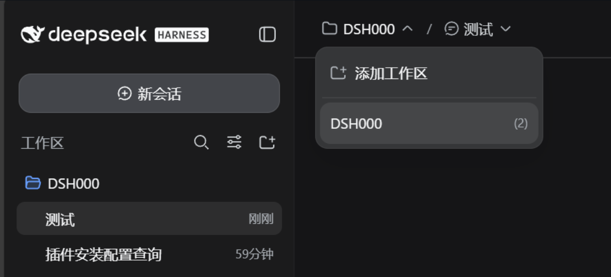
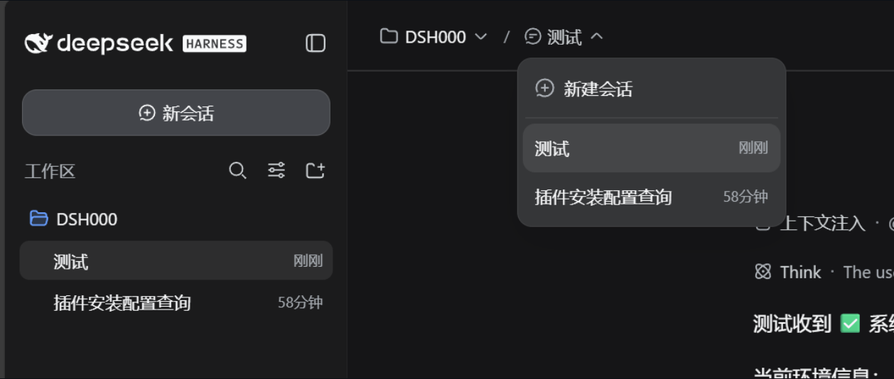
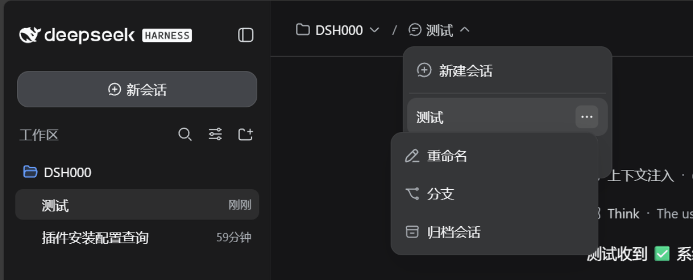

<p align="center">
  
</p>

<p align="center">
  
  
  
  
</p>

<p align="center"><sub><a href="README.md">简体中文</a> · English</sub></p>

<h3 align="center">Replace the DSH topbar session title with a two-level "Workspace / Session" breadcrumb — switch right from the topbar</h3>

<p align="center"><a href="#install"><ins><code>dsh plugin --profile web add github:xinspark/dsh-better-session-title#v1.2.0</code></ins></a></p>

Better Session Title is a **session-topbar enhancement plugin** for [DeepSeek Harness](https://github.com/deepseek-ai/deepseek-harness) — pure UI enhancement, no new capabilities, no system source changes. DSH's native topbar shows only the session title (an ancestry breadcrumb) in the center, while workspace/session switching lives in the left sidebar; when the sidebar is collapsed, every switch costs extra clicks. This plugin puts the switching entry right into the topbar:

- **Workspace dropdown** — all workspaces with their session counts, one-click switch, plus "New workspace" (native directory picker) and delete.
- **Session dropdown** — all sessions of the current workspace with relative timestamps, one-click switch, plus "New session".

All inline row actions reuse native DSH capabilities: rename workspace/session, delete workspace, fork session, archive session — identical to the native sidebar behavior.

Works on **Windows · macOS · Linux** (DSH Web GUI) — plain JavaScript, no native dependencies, no build step for distribution.

> Verification baseline: **DeepSeek Harness 0.2.0-rc.2** (DSH Desktop and `dsh web`). Other versions are untested.

## Install

`dsh-better-session-title` is a **bundle** — a configuration patch layer distributed as a package (see the [official DSH plugin publishing docs](https://deepseek-harness.github.io/deepseek-harness/develop/basic/publish)). Install it into a profile with `dsh plugin`: it links the package and appends it to `dsh.profile.bundles`:

```sh
# from GitHub (primary channel; v1.2.0 is the current release tag)
dsh plugin --profile web add github:xinspark/dsh-better-session-title#v1.2.0
```

- **Consider locking a commit**: a GitHub install pulls the repository source, so later pushes don't silently change what you run. To pin the exact content, use `github:xinspark/dsh-better-session-title#<commit-sha>` (as recommended by the official docs).
- **Local directory / tarball** (development or offline):

  ```sh
  dsh plugin --profile web add ./dsh-better-session-title
  dsh plugin --profile web add ./dsh-better-session-title-1.2.0.tgz
  ```

Then start the Web UI: `dsh web` (or `dsh --profile web`). The first `add` auto-initializes the profile with `@deepseek-ai/dsh-base`.

Uninstall: `dsh plugin --profile web remove dsh-better-session-title` (removes the dependency and the composition layer).

The bundle patch (`cordis.patch.yml`) registers both the host and client halves automatically. The client half is served on demand: client changes apply after a page refresh; host changes need a restart.

## Features

| Capability | Description |
| --- | --- |
| Multi-level breadcrumb | The topbar shows "Workspace / Session", each segment expanding its own dropdown; inside a subagent session it grows to "Workspace / parent / subagent session" (ancestor levels navigate back). |
| Per-level icon fallback | Levels fall back to icons only when the topbar genuinely runs out of room: **the whole row overflows → every level collapses** (so it is never cut off at the window edge), and **a level squeezed below a readable width** (visible label < 80px ≈ 5 CJK characters) → that level collapses. Icons are per level (workspace = folder, plain session = session glyph, subagent = the native switcher's up/down chevrons); the full title stays in the tooltip and the accessible name. A level whose title merely exceeds its own cap keeps the truncated text — that carries more information than an icon. The `/` separators always stay, so the hierarchy remains readable in icon form. |
| Workspace dropdown | Workspace list (session-count meta), New workspace (native directory picker), row "more": rename / delete workspace. |
| Session dropdown | Session list of the current workspace (relative-time meta), New session, row "more": rename / fork / archive session. |
| Native-consistent interactions | The dropdown is a self-drawn layer that reuses the native menu tokens (`--dsw-elevation-prominent`, `--dsw-radius-lg`, `--dsw-menu-surface-fill` + `--dsw-menu-backdrop-filter`, hover fill `--dsw-alias-interactive-bg-hover`); its row metrics are min-height 40 / padding 8·10 / 14px·22px (matching the native `AccountMenu` `[role=menuitem]`; the native `Menu.module.css` is more compact and this plugin does not follow it). The more menu and rename/delete dialogs use the native `Menu` / `Modal` / `Button` / `Input` (autoFocus, select-all, IME-safe Enter, duplicate workspace-name check, error rows). |
| Shared lifecycle | The more menu closes with its owning dropdown (outside click / Escape / selection / switching) — no orphan menus. |
| Bilingual | Built-in zh/en dictionaries that follow the DSH language switch live. |

## Screenshots

**Session dropdown open** — switch sessions, create new:



**Session "more" menu** — hover the row end for rename / fork / archive:



**Workspace dropdown open** — switch workspaces, new workspace:


## Usage

After installation, open any session — the topbar center shows the "Workspace / Session" breadcrumb:

- Click the **workspace** side: the workspace dropdown opens ("New workspace" on top).
- Click the **session** side: the session dropdown opens ("New session" on top).
- Hover a row: the "More" button appears at the row end (rename / fork / archive etc., per row type).
- Select a row to switch; click outside or press `Esc` to close the dropdown.

## Relationship with DSH

This project is built on the official [deepseek-ai/deepseek-harness](https://github.com/deepseek-ai/deepseek-harness) and is a **community plugin** — not an official DeepSeek product. Everything it shows is DSH's own data and UI, re-arranged; no system source changes.

## Development

- **`index.js`** — host half: minimal no-op (a pure UI plugin; all logic lives in the browser half).
- **`lib/client.js`** — browser half (UMD, registered into DSH `clientModules`). Structure, top to bottom:
  1. Local utilities: style injection / timers.
  2. **Bilingual dictionaries** (`BST_ZH` / `BST_EN`) — registered into `ctx.locale`, following the language switch; `bstT()` falls back gracefully.
  3. **Self-drawn dropdown** `BstList` — native menu styling and tokens; viewport-aware positioning; outside close on `click` (not mousedown/pointerdown: those dispatch before `click`, unload the list first and swallow inline clicks).
  4. `WorkspaceTitleBreadcrumb` — registered into `conversation.session.header.actions` (`order: -40`, leftmost in the topbar); per-level icon fallback (a level drops its text only once the topbar squeezes it below `ICONIC_TEXT_FLOOR` of visible label width; recovery uses a header-width hysteresis, so it never flaps); the more menu shares the dropdown lifecycle; rename/delete use native Modals.
  5. `apply(ctx)` — style injection + slot registration with `inject: ['slots','workspaces','sessions','uiWorkspace','locale']` (declaring the service dependencies matters: if `apply` wins the race, `undefined` handles get captured permanently and every action dies silently while the UI still looks perfect).

Quick reference:

- **Add a row action** — add an entry to the `actions` array of `wsListItems` / `ssListItems` (`{ id, label, icon?, danger?, action }`).
- **Add copy** — add a key to the `BST_ZH` / `BST_EN` dictionaries.
- **Tweak dropdown styles** — edit the `.bst-item*` rules in `insertStyle` (tokens match the native Menu).
- **Change the icon-fallback threshold** — the threshold is `ICONIC_TEXT_FLOOR` (≈5 CJK characters wide): a level falls back to its icon only when its label is truncated *and* its visible width is below it, or when the whole row overflows. Two traps: (1) do not use "the title exceeds this level's `max-width`" as the predicate — that also matches in a wide window (a long title exceeds the cap by nature) and the UI would turn into icons everywhere; (2) do not assume the label always gets squeezed — topbar containers are not shrinkable by default, and the overflow shows up as clipping at the window edge instead (see the `has(.bst-crumbs)` rule that makes them shrinkable).
- **Add another chain level** — change `bstSessionChain` (data) only; the render path is one shared block per level, with the icon picked by `node.subagent` (subagent = up/down chevrons, otherwise the session glyph), so no chain length can produce a level without an icon.
- **The dropdown must be portaled into `document.body`** — rendered in place inside the topbar slot it sits in the header's stacking context, so page content (including a third-party plugin's injected `复制` button) paints over it, and the app shell's sidebar column can cover its first row. The native `Menu`'s `portal: true` exists for the same reason.
- **Do not reuse the native wording for action rows** — "mobile pocket" plugins (measured: `dsh-pocket` 2.11.0 `hideWsEntries`) scan every `[role=menuitem]`/`[role=option]`/`li`/`button`/`a` and hide the ones whose text **exactly** matches `添加工作区` / `Add workspace`, with a `MutationObserver` that keeps newly inserted nodes hidden too. Reusing the native label made that row vanish from our dropdown; keeping our own wording (`新建工作区` / `New workspace`) avoids it.

## Acknowledgments

Thanks to [DeepSeek Harness](https://github.com/deepseek-ai/deepseek-harness) and the DeepSeek AI team — the agent, models, tools, sessions, Web UI and plugin ecosystem all come from this project; to [Cordis](https://github.com/cordiverse/cordis) for the plugin foundation; and to the [Koishi.js](https://koishi.chat/) community for its long-standing plugin practices, tooling and experience.

## License

[MIT](LICENSE) — fully open source and free.

Better Session Title is a community plugin for DeepSeek Harness — **not a DeepSeek official product**.
