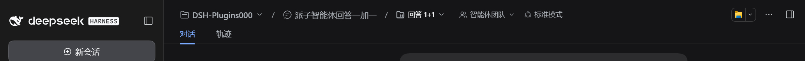

<p align="center">
  
</p>

<p align="center">
  
  
  
  
</p>

<p align="center"><sub><a href="README.md">简体中文</a> · English</sub></p>

<h3 align="center">Replace the DSH topbar session title with a two-level "Workspace / Session" breadcrumb — switch right from the topbar</h3>

<p align="center"><a href="#install"><ins><code>dsh plugin --profile web add github:xinspark/dsh-better-session-title#v1.3.5</code></ins></a></p>

Better Session Topbar (package name `dsh-better-session-title`) is a **session-topbar enhancement plugin** for [DeepSeek Harness](https://github.com/deepseek-ai/deepseek-harness) — pure UI enhancement, no new capabilities, no system source changes. DSH's native topbar shows only the session title (an ancestry breadcrumb) in the center, while workspace/session switching lives in the left sidebar; when the sidebar is collapsed, every switch costs extra clicks. This plugin puts the switching entry right into the topbar:

- **Workspace dropdown** — all workspaces with their session counts, one-click switch, plus "New workspace" (native directory picker) and delete.
- **Session dropdown** — all sessions of the current workspace with relative timestamps, one-click switch, plus "New session".
- **The three native topbar chips are brought in line too** — 子智能体 / 智能体团队 / 后台任务 and the breadcrumb share one set of metrics (type size, padding, corners, hover fill, icon size) and give way in a fixed order: chips drop to their counters → the title steps aside for icons → the chips become icons.
- **Two narrow-screen displays** — when the row truly runs out of room, pick **Breadcrumb** (folds to icons; every level stays clickable) or **Session title** (the row keeps only the title). Each option's trade-off is written next to it on the plugin page.

All inline row actions reuse native DSH capabilities: rename workspace/session, delete workspace, fork session, archive session — identical to the native sidebar behavior.

Works on **Windows · macOS · Linux** (DSH Web GUI) — plain JavaScript, no native dependencies, no build step for distribution.

> Verification baseline: **DeepSeek Harness 0.2.1-rc.2** (DSH NEXT Desktop and `dsh web`); 0.2.0-rc.2 stays compatible since 1.2.1. Other versions are untested.

## Install

`dsh-better-session-title` is a **bundle** — a configuration patch layer distributed as a package (see the [official DSH plugin publishing docs](https://deepseek-harness.github.io/deepseek-harness/develop/basic/publish)). Install it into a profile with `dsh plugin`: it links the package and appends it to `dsh.profile.bundles`:

```sh
# from GitHub (primary channel; v1.3.5 is the current release tag)
dsh plugin --profile web add github:xinspark/dsh-better-session-title#v1.3.5
```

- **Consider locking a commit**: a GitHub install pulls the repository source, so later pushes don't silently change what you run. To pin the exact content, use `github:xinspark/dsh-better-session-title#<commit-sha>` (as recommended by the official docs).
- **Local directory / tarball** (development or offline):

  ```sh
  dsh plugin --profile web add ./dsh-better-session-title
  dsh plugin --profile web add ./dsh-better-session-title-1.3.5.tgz
  ```

Then start the Web UI: `dsh web` (or `dsh --profile web`). The first `add` auto-initializes the profile with `@deepseek-ai/dsh-base`.

Uninstall: `dsh plugin --profile web remove dsh-better-session-title` (removes the dependency and the composition layer).

The bundle patch (`cordis.patch.yml`) registers both the host and client halves automatically. The client half is served on demand: client changes apply after a page refresh; host changes need a restart.

## Features

| Capability | Description |
| --- | --- |
| Multi-level breadcrumb | The topbar shows "Workspace / Session", each segment expanding its own dropdown; inside a subagent session it grows to "Workspace / parent / subagent session" (ancestor levels navigate back). |
| Per-level icon fallback | Levels fall back to icons only when the topbar genuinely runs out of room: **the whole row overflows → every level collapses** (so it is never cut off at the window edge), and **a level squeezed below a readable width** (visible label < 80px ≈ 5 CJK characters) → that level collapses. Icons are per level (workspace = folder, plain session = session glyph, subagent = the native switcher's up/down chevrons); the full title stays in the tooltip and the accessible name. A level whose title merely exceeds its own cap keeps the truncated text — that carries more information than an icon. The `/` separators always stay, so the hierarchy remains readable in icon form. |
| Width ladder | When the row runs out of room the segments give way in one fixed order: the three native chips (子智能体 / 智能体团队 / 后台任务) go `full → count` (label replaced by the `(N)` badge) → **the whole breadcrumb collapses to icons** (the counters survive, a long title is the least valuable thing on the row) → the chips go `count → icon`. Every decision comes from the measured free width, never from a remembered header width, so a longer title or a vanished chip unfolds by itself. |
| Narrow-screen display | Two options on the plugin page: **Breadcrumb** (the default — keeps the workspace / session levels, each still clickable for switching after folding to icons; the cost is that at the narrowest only icons remain, so the full title needs a hover or a click) or **Session title** (the row keeps only the current session title — the parent / current pair inside a subagent session — so long titles stay readable; the cost is that the workspace and switching move into the dropdown, and at the narrowest the parent becomes the up/down arrow glyph). Both take effect at the same fold point and preview live. |
| Chip parity | The three native chips share one anatomy — icon · label · (N) · ring · chevron — with identical 12px/18 type, `3px 7px` padding, 5px gap, 28px height, 14px icon, 12px chevron, corners and hover fill. What the native ones lack is added (the team chip gets a member count and a running ring phase-pinned to the official spinner), and what one of them orders differently is normalised (the jobs chip's running dot moves after the counter). |
| Workspace dropdown | Workspace list (session-count meta), New workspace (native directory picker), row "more": rename / delete workspace. |
| Session dropdown | Session list of the current workspace (relative-time meta), New session, row "more": rename / fork / archive session. |
| Native-consistent interactions | The dropdown is a self-drawn layer that reuses the native menu tokens (`--dsw-elevation-prominent`, `--dsw-radius-lg`, `--dsw-menu-surface-fill` + `--dsw-menu-backdrop-filter`, hover fill `--dsw-alias-interactive-bg-hover`); its row metrics are min-height 40 / padding 8·10 / 14px·22px (matching the native `AccountMenu` `[role=menuitem]`; the native `Menu.module.css` is more compact and this plugin does not follow it). The more menu and rename/delete dialogs use the native `Menu` / `Modal` / `Button` / `Input` (autoFocus, select-all, IME-safe Enter, duplicate workspace-name check, error rows). |
| Shared lifecycle | The more menu closes with its owning dropdown (outside click / Escape / selection / switching) — no orphan menus. |
| Plugin page | Plugins → this plugin → Configure: **narrow-screen session title display** (a two-option selector shaped like DSH's own appearance cubes — Breadcrumb / Session title, each with its trade-off spelled out) and the **probe log** switch. Both apply immediately and persist to the profile's Cordis patch. |
| Bilingual | Built-in zh/en dictionaries that follow the DSH language switch live. |

## Screenshots

**Workspace dropdown open** — switch workspaces, new workspace:


**Session dropdown open** — switch sessions, create new:


**Session "more" menu** — hover the row end for rename / fork / archive:


**Subagent ancestry crumb** — inside a subagent session the breadcrumb grows to "Workspace / parent / subagent session"; ancestors navigate back and the last level opens the sibling subagents:



**Narrow screen, session-title display** — once the full breadcrumb no longer fits, the row keeps only the current session title (clicking it opens the same session list and inline actions):


**Plugin page** — the two display options with their trade-offs, plus the probe log switch:


## Usage

After installation, open any session — the topbar center shows the "Workspace / Session" breadcrumb:

- Click the **workspace** side: the workspace dropdown opens ("New workspace" on top).
- Click the **session** side: the session dropdown opens ("New session" on top).
- Hover a row: the "More" button appears at the row end (rename / fork / archive etc., per row type).
- Select a row to switch; click outside or press `Esc` to close the dropdown.
- When the topbar runs out of room it gives way in the fixed order above; to change the narrow-screen display, open Plugins → Better Session Topbar → Configure.

## Relationship with DSH

This project is built on the official [deepseek-ai/deepseek-harness](https://github.com/deepseek-ai/deepseek-harness) and is a **community plugin** — not an official DeepSeek product. Everything it shows is DSH's own data and UI, re-arranged; no system source changes.

## Development

- **`index.js`** — host half: it only declares the schema of the two settings (`narrowMode` / `probeLog`); every piece of UI logic lives in the browser half.
- **`lib/client.js`** — browser half (UMD, registered into DSH `clientModules`). Structure, top to bottom:
  1. Local utilities: style injection / timers.
  2. **Bilingual dictionaries** (`BST_ZH` / `BST_EN`) — registered into `ctx.locale`, following the language switch; `bstT()` falls back gracefully.
  3. **Self-drawn dropdown** `BstList` — native menu styling and tokens; viewport-aware positioning; outside close on `click` (not mousedown/pointerdown: those dispatch before `click`, unload the list first and swallow inline clicks).
  4. `WorkspaceTitleBreadcrumb` — registered into `conversation.session.header.actions` (`order: -40`, leftmost in the topbar); per-level icon fallback (a level drops its text only once the topbar squeezes it below `ICONIC_TEXT_FLOOR` of visible label width) plus the decoration and width ladder for the three native chips (every decision comes from the measured free width, `avail()`; **no** header-width hysteresis — folds are usually caused by a rename or a newly appeared chip, and a fold keyed on header width never comes back); the more menu shares the dropdown lifecycle; rename/delete use native Modals.
  5. `apply(ctx)` — style injection + slot registrations (topbar breadcrumb and the plugin page); `inject: ['slots','workspaces','sessions','uiWorkspace','locale','shortcuts']` (declaring the service dependencies matters: if `apply` wins the race, `undefined` handles get captured permanently and every action dies silently while the UI still looks perfect). The settings service is an **optional** dependency, taken through a `ctx.inject(['configForms'], …)` child: without it you lose the page, not the breadcrumb.

Quick reference:

- **Add a row action** — add an entry to the `actions` array of `wsListItems` / `ssListItems` (`{ id, label, icon?, danger?, action }`).
- **Add copy** — add a key to the `BST_ZH` / `BST_EN` dictionaries.
- **Tweak dropdown styles** — edit the `.bst-item*` rules in `insertStyle` (tokens match the native Menu).
- **Diagnostics are off by default; the switch lives on the plugin page** — normal use writes nothing to the console. Turn on **Probe logs** under Plugins → this plugin → Configure (applies immediately, no reload). The three prefixes are `[bst-dom]` (structural probe), `[bst-chip]` (chip discovery and ladder conclusions) and `[bst-perf]` (only emitted when a single pass takes longer than 60ms). While it is off, even the structural probe's measurements are skipped. The value is stored in the profile's `cordis.patch.yml`, so it follows the profile.
- **A host-half change does not need an app restart** — verified live: client changes apply on refresh, and an `index.js` change is picked up by toggling this row off and on in the Plugins page (`已关闭 → 运行中`), which re-imports it so a newly declared `Config` takes effect immediately.
- **The schema needs schemastery (a peer)** — the host half builds `Config` with `@deepseek-ai/schemastery`, declared as a peerDependency in `package.json` (DSH already provides it at the profile root). If you install this repository as a **symlink** while developing, note that Node resolves through the real path, so the plugin cannot see that package — point a `node_modules/@deepseek-ai/schemastery` junction/symlink at it (`node_modules/` is git-ignored). A real-directory install (`dsh plugin add`) does not need this.
- **The narrow-screen mode is an enum, not a boolean** — `narrowMode` is `'crumb' | 'title'` (host side: `z.union([z.const(...), z.const(...)])`). Up to 1.3.4 the stored field was the boolean `narrowTitle`; after the rename the old value is dropped by the schema, so the plugin falls back to the default Breadcrumb display — pick the other option on the plugin page.
- **Why the selector is not a SegmentedControl** — the native `SegmentedControl` is tablist → panel semantics (each option carries an `aria-controls` pointing at a panel); there is no panel here, so it would emit dangling `aria-controls` references. The two-option selector reuses the cube DSH itself uses for its appearance picker: `.5px` border, `--dsw-radius-xl`, selected state swapping to `--dsw-alias-bg-module-platform` + `--dsw-static-neutral-bluish-400`, with `aria-pressed` carrying the selection.
- **Invariants of the narrow title state** — (1) the workspace level is hidden with `display: none` via `data-bst-level="ws"`; do **not** stop rendering it, because `crumbNeed` is derived from the `.bst-crumb-btn` count and removing it drops the threshold from 285 to 151, which makes the layout flap between hidden and shown; (2) the state forces the text form (`setIconic('')`), otherwise the ladder would fold the last level into a glyph, which contradicts what a title is; (3) the session icon lives inside `span.bst-crumb-icon` and is hidden only in this state — the wide breadcrumb keeps it; (4) inside a subagent session the `parent / current` pair compresses one step further: when `per` bottoms out (150) the parent turns into the native up/down switcher glyph and gives its width to the title, expanding again at 190 — the glyph is the **exception** to the icon hiding (`.bst-crumb-iconic .bst-crumb-icon` must be restored in this state), otherwise collapsing would leave an empty button.
- **Adding a setting touches two places** — declare the field in the host half's `Config` schema and mark it `.volatile()` (only volatile fields ride the form; a schema without one makes the whole row disappear); then add a control in `BstSettingsPage`, reading `configForms.get(row id)` and writing through the same instance with `set(field, value)`. The topbar reads the shared `bstSettings`, which is recomputed whenever the form changes.
- **Change the width ladder** — the ladder is `full → count → icons → icon` and its thresholds are three constants: `CRUMB_LEVEL_COST` / `CRUMB_SEP_COST` (turned into `crumbNeed` from the current level count; 285 for two levels), `CRUMB_ICON_NEED` (160 — only below that does a chip become an icon) and `CRUMB_TEXT_ADD` (136, the margin required to unfold). Recompute them if you touch type size, padding or icon size — do not hard-code an integer. Do **not** add a `header.clientWidth` hysteresis: folds are usually caused by content changes (a rename, a new chip), and a fold keyed on header width never comes back. The chip metrics live in the `button[data-bst-chip]` rules; the decoration (counter, ring, dot order) is driven by the `data-bst-chip-*` markers.
- **Change the icon-fallback threshold** — the threshold is `ICONIC_TEXT_FLOOR` (≈5 CJK characters wide): a level falls back to its icon only when its label is truncated *and* its visible width is below it, or when the whole row overflows. Two traps: (1) do not use "the title exceeds this level's `max-width`" as the predicate — that also matches in a wide window (a long title exceeds the cap by nature) and the UI would turn into icons everywhere; (2) do not assume the label always gets squeezed — topbar containers are not shrinkable by default, and the overflow shows up as clipping at the window edge instead (see the `has(.bst-crumbs)` rule that makes them shrinkable).
- **Add another chain level** — change `bstSessionChain` (data) only; the render path is one shared block per level, with the icon picked by `node.subagent` (subagent = up/down chevrons, otherwise the session glyph), so no chain length can produce a level without an icon.
- **The dropdown must be portaled into `document.body`** — rendered in place inside the topbar slot it sits in the header's stacking context, so page content (including a third-party plugin's injected `复制` button) paints over it, and the app shell's sidebar column can cover its first row. The native `Menu`'s `portal: true` exists for the same reason.
- **Do not reuse the native wording for action rows** — "mobile pocket" plugins (measured: `dsh-pocket` 2.11.0 `hideWsEntries`) scan every `[role=menuitem]`/`[role=option]`/`li`/`button`/`a` and hide the ones whose text **exactly** matches `添加工作区` / `Add workspace`, with a `MutationObserver` that keeps newly inserted nodes hidden too. Reusing the native label made that row vanish from our dropdown; keeping our own wording (`新建工作区` / `New workspace`) avoids it.

## Acknowledgments

Thanks to [DeepSeek Harness](https://github.com/deepseek-ai/deepseek-harness) and the DeepSeek AI team — the agent, models, tools, sessions, Web UI and plugin ecosystem all come from this project; to [Cordis](https://github.com/cordiverse/cordis) for the plugin foundation; and to the [Koishi.js](https://koishi.chat/) community for its long-standing plugin practices, tooling and experience.

## License

[MIT](LICENSE) — fully open source and free.

Better Session Topbar is a community plugin for DeepSeek Harness — **not a DeepSeek official product**.
