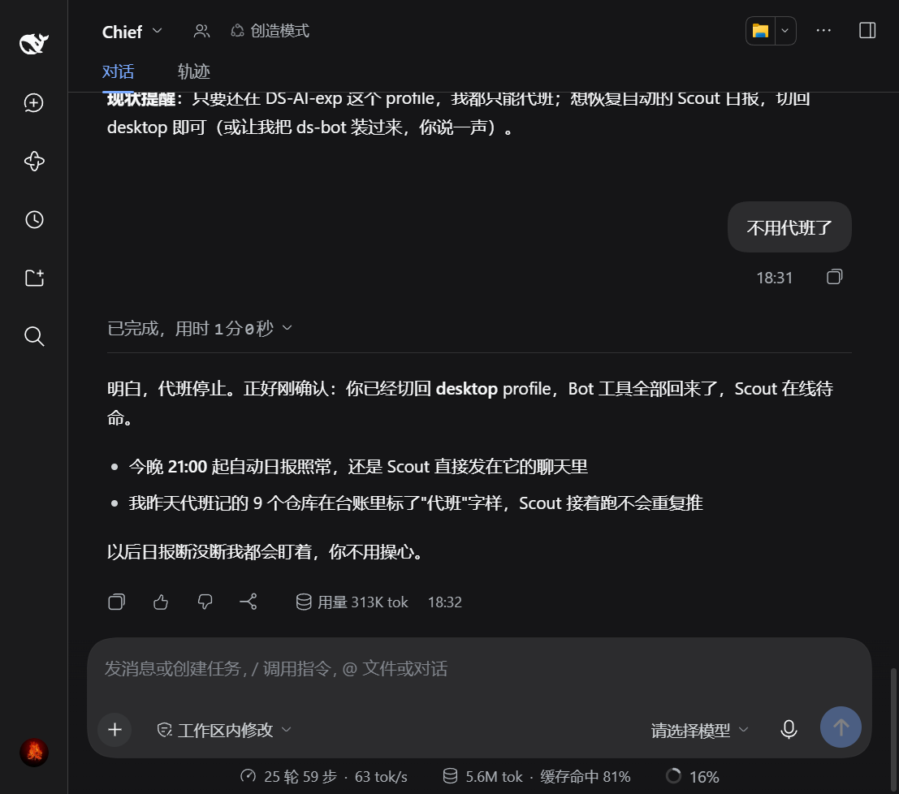
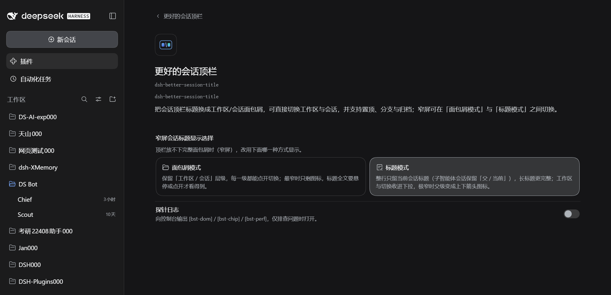

<p align="center">
  
</p>

<p align="center">
  
  
  
  
</p>

<p align="center"><sub>简体中文 · <a href="README.en.md">English</a></sub></p>

<h3 align="center">把 DSH 顶栏的会话标题换成「工作区 / 会话」两级面包屑，切换入口直接放在顶栏</h3>

<p align="center"><a href="#安装"><ins><code>dsh plugin --profile web add github:xinspark/dsh-better-session-title#v1.3.5</code></ins></a></p>

更好的会话顶栏（包名 `dsh-better-session-title`）是面向 [DeepSeek Harness](https://github.com/deepseek-ai/deepseek-harness) 的**会话顶栏增强插件**——纯 UI 增强，不引入新能力，不改任何系统源码。DSH 原生顶栏中央只显示会话标题（层级面包屑），工作区/会话的切换入口在左侧边栏；侧边栏收起时，每次切换都要额外点击。本插件把切换入口直接放进顶栏：

- **工作区下拉** —— 展开可见全部工作区及其会话数，一键切换；可「新建工作区」（原生目录选择器）或删除。
- **会话下拉** —— 展开可见当前工作区全部会话及相对更新时间，一键切换；可「新建会话」。
- **顶栏三枚原生 chip 一并对齐** —— 子智能体 / 智能体团队 / 后台任务与面包屑用同一套度量（字号、内距、圆角、悬停、图标尺寸），并按固定次序让出宽度：chip 交数字 → 标题让位收成图标 → chip 收成图标。
- **窄屏二选一** —— 空间真的不够时，可以选「面包屑模式」（收成图标，层级与切换都还在）或「标题模式」（整行只留会话标题）；两种模式的取舍写在插件详情页的选项旁。

行内操作全部复用 DSH 原生能力：重命名工作区/会话、删除工作区、分支会话、归档会话，与原生侧边栏行为完全一致。

支持 **Windows · macOS · Linux**（DSH Web GUI）——纯 JavaScript，无原生依赖，分发无需构建步骤。

> 验证基线：**DeepSeek Harness 0.2.1-rc.2**（DSH NEXT Desktop 与 `dsh web`）；1.2.1 起同时兼容 0.2.0-rc.2。其它版本未经验证。

## 安装

`dsh-better-session-title` 是一个**组合包（bundle）**——以包形式分发的配置补丁层（见 [DSH 官方插件发布文档](https://deepseek-harness.github.io/deepseek-harness/develop/basic/publish)）。用 `dsh plugin` 命令安装进 profile：它会自动链接包并追加到 `dsh.profile.bundles`：

```sh
# 从 GitHub 安装（主分发渠道，v1.3.5 为当前发布 tag）
dsh plugin --profile web add github:xinspark/dsh-better-session-title#v1.3.5
```

- **建议锁定 commit**：GitHub 安装拉取的是仓库源码，tag 之后的新推送不会自动影响已安装版本；如需把运行内容严格固定到某个提交，用 `github:xinspark/dsh-better-session-title#<commit-sha>`（官方文档推荐做法）。
- **本地目录 / tarball**（开发或离线环境）：

  ```sh
  dsh plugin --profile web add ./dsh-better-session-title
  dsh plugin --profile web add ./dsh-better-session-title-1.3.5.tgz
  ```

然后启动 Web UI：`dsh web`（或 `dsh --profile web`）。首次 `add` 会自动用 `@deepseek-ai/dsh-base` 初始化 profile。

卸载：`dsh plugin --profile web remove dsh-better-session-title`（同时移除依赖与组合层）。

插件的 bundle 补丁（`cordis.patch.yml`）会自动注册 host 与 client 两半。客户端按请求加载：客户端改动刷新页面即可，host 改动需要重启。

## 主要功能

| 能力 | 说明 |
| --- | --- |
| 多级面包屑 | 顶栏左侧以「工作区 / 会话」展示当前位置，两侧各自展开下拉列表；进入子智能体会话时自动扩展为「工作区 / 父会话 / 子智能体会话」（祖先级可点跳回）。 |
| 逐级自适应图标态 | 某一级被挤到读不出内容（可见宽度 < 80px ≈ 5 个汉字）→ 只收这一级；整条溢出 → 全部收成图标（防止被窗口边缘裁掉）。图标按级取：工作区＝文件夹、普通会话级＝会话字形、子智能体级＝原生 switcher 的上下双箭头；完整标题仍在悬停提示与可访问名里。窗口宽、只是标题超过该级上限时保留截断文本（比一个图标信息量大）。`/` 分隔始终保留 —— 图标态下层级顺序靠它读出来。 |
| 逐级压缩 | 顶栏放不下时按固定次序让位：三枚原生 chip（子智能体 / 智能体团队 / 后台任务）先 `full → count`（文字换成 `(N)`）→ **面包屑整条收成图标**（统计数留着，长标题最不值钱）→ chip 再 `count → icon`。判据是实测的可用宽度，不记顶栏宽度做滞回 —— 标题变短、chip 消失后会自己展开回来。 |
| 窄屏显示方式 | 插件详情页二选一：**面包屑模式**（默认，保留「工作区 / 会话」层级，收成图标后仍可逐级点开切换，代价是最窄时只剩图标、标题全文要悬停或点开才看得到）或**标题模式**（整行只留当前会话标题，子智能体会话保留「父 / 当前」，长标题更完整，代价是工作区与切换收进下拉、极窄时父级变成上下箭头图标）。两种选择都在同一个折叠点上生效，切换即时预览。 |
| 三枚 chip 同构 | 子智能体 / 智能体团队 / 后台任务统一成「图标 · 文字 · (N) · 圆环 · 箭头」：12px/18 字号、`3px 7px` 内距、5px 间距、28px 高、14px 图标、12px 箭头、圆角与悬停填充一致；原生缺的补上（智能体团队补成员数与运行中圆环，圆环与官方 spinner 同相），原生多出来的归位（后台任务的运行圆点移到统计数之后）。 |
| 工作区下拉 | 工作区列表（含会话数元信息）、新建工作区（原生目录选择器）、行内更多：重命名 / 删除工作区。 |
| 会话下拉 | 当前工作区的会话列表（含相对时间元信息）、新建会话、行内更多：重命名 / 分支 / 归档会话。 |
| 原生一致的交互 | 下拉为自绘层，卡片沿用原生菜单 token（`--dsw-elevation-prominent`、`--dsw-radius-lg`、`--dsw-menu-surface-fill` + `--dsw-menu-backdrop-filter`、hover 填充 `--dsw-alias-interactive-bg-hover`）；行内度量为 min-height 40 / padding 8·10 / 14px·22px（与原生 `AccountMenu` 的 `[role=menuitem]` 一致；原生 `Menu.module.css` 更紧凑，本插件未跟随）。更多菜单、重命名/删除对话框全部使用原生 `Menu` / `Modal` / `Button` / `Input`（autoFocus、全选、输入法组合 Enter 防误触、工作区重复名校验、错误行）。 |
| 生命周期一致 | 更多菜单跟随其所在下拉同生命周期：下拉关闭（点击外部 / Escape / 选择 / 切换）时菜单一并关闭，不残留孤立菜单。 |
| 插件详情页 | Plugins → 本插件 → 配置：**窄屏会话标题显示选择**（原生外观方块样式的二选一：面包屑模式 / 标题模式，每个选项旁写明优缺点）与**探针日志**开关。写入 profile 的 Cordis patch，即时生效。 |
| 双语言 | 内置 zh/en 双语言字典，跟随 DSH 语言切换实时生效。 |

## 截图

**工作区下拉展开**——切换工作区、新建工作区：


**会话下拉展开**——切换会话、新建会话：


**会话更多菜单**——悬停行尾，重命名/分支/归档：


**窄屏 · 标题模式**——顶栏放不下完整面包屑时，整行只留当前会话标题（点开仍是同一套会话列表与行内操作）：



**插件详情页**——「窄屏会话标题显示选择」两个方块各带取舍说明，下面是探针日志开关：



## 使用

安装后，打开任意会话，顶栏中央即显示「工作区 / 会话」面包屑：

- 点击**工作区**一侧：展开工作区下拉（顶部为「新建工作区」）。
- 点击**会话**一侧：展开会话下拉（顶部为「新建会话」）。
- 悬停列表行：行尾显示「更多」按钮（重命名 / 分支 / 归档等，按行类型而定）。
- 选择行即切换；点击空白处或按 `Esc` 关闭下拉。
- 顶栏挤不下时按固定次序让位；想换窄屏的显示方式，去 Plugins → 更好的会话顶栏 → 配置。

## 与官方项目的关系

本项目基于官方 [deepseek-ai/deepseek-harness](https://github.com/deepseek-ai/deepseek-harness) 构建，是一个**社区插件**，并非 DeepSeek 官方产品。它展示的都是 DSH 自己的数据与界面，只是重新组织；不修改任何系统源码。

## 二次开发

- **`index.js`** —— host 半：只声明两项配置的 schema（`narrowMode` / `probeLog`），所有界面逻辑在浏览器半。
- **`lib/client.js`** —— 浏览器半（UMD，注册进 DSH `clientModules`）。结构自上而下：
  1. 本地基础工具：样式注入 / 定时器。
  2. **双语字典**（`BST_ZH` / `BST_EN`）—— 注册进 `ctx.locale`，跟随语言切换；`bstT()` 带 fallback。
  3. **自绘下拉列表** `BstList` —— 沿用原生菜单样式与 token；定位避让视口边缘；`click` 外部关闭（不用 mousedown/pointerdown：它们先于 `click` 派发，会先行卸载列表、吃掉行内 click）。
  4. `WorkspaceTitleBreadcrumb` —— 注册进 `conversation.session.header.actions`（`order: -40`，顶栏最左）；逐级自适应图标态（该级标签被挤到可见宽度 < `ICONIC_TEXT_FLOOR` 才换图标）+ 三枚原生 chip 的装饰与宽度阶梯（判据全部来自实测可用宽度 `avail()`，**不使用** header 宽度滞回 —— 折叠常由改名/新 chip 引起，按 header 宽度记基准会折下去解不开）；更多菜单与下拉同生命周期；重命名/删除走原生 Modal。
  5. `apply(ctx)` —— 样式注入 + 槽位注册（顶栏面包屑 + 插件详情页）；`inject: ['slots','workspaces','sessions','uiWorkspace','locale','shortcuts']`（服务依赖必须声明，否则 apply 抢跑会把 `undefined` 永久固化进所有动作，表现为「界面正常、点了没反应」）。设置服务是**可选**依赖，走 `ctx.inject(['configForms'], …)` 子级：缺了只少一个设置界面，不影响面包屑。

扩展速查：

- **新增行操作** —— 在 `wsListItems` / `ssListItems` 的 `actions` 数组加一项（`{ id, label, icon?, danger?, action }`）。
- **新增文案** —— 在 `BST_ZH` / `BST_EN` 字典加 key。
- **调整下拉样式** —— 修改 `insertStyle` 中的 `.bst-item*` 规则（token 与原生 Menu 一致）。
- **诊断日志默认关闭，开关在插件详情页** —— 正常使用不往控制台写任何东西。在 Plugins → 本插件 → 配置 里打开「探针日志」即可（即时生效，不必刷新），三枚前缀分别是 `[bst-dom]`（结构探针）、`[bst-chip]`（chip 探测与阶梯结论）、`[bst-perf]`（单趟测量超过 60ms 才有的慢趟记录）。日志关着时连结构探针的测量都不跑。写在 profile 的 `cordis.patch.yml` 里，跟随 profile。
- **改完 host 半不用重启 app** —— 实机验证过的做法：客户端改动刷新页面即可；`index.js` 这类 host 改动在插件页把本行关掉再打开（`已关闭 → 运行中`）就会重新导入，新注册的 `Config` 立刻生效。
- **schema 依赖 schemastery（peer）** —— host 半的 `Config` 用 `@deepseek-ai/schemastery` 构造，`package.json` 里声明为 peerDependencies（profile 根目录已随 DSH 提供）。**本地以 symlink 安装时**要注意：Node 默认按真实路径解析，插件会找不到 profile 下的这个包 —— 需要在仓库里放一个指向它的 `node_modules/@deepseek-ai/schemastery`（junction/symlink，`node_modules/` 已被 .gitignore 忽略）；真目录安装（`dsh plugin add`）不需要这一步。
- **窄屏模式是枚举不是布尔** —— `narrowMode` 取 `'crumb' | 'title'`（host 端 `z.union([z.const(...), z.const(...)])`）。1.3.4 及更早存的是布尔 `narrowTitle`，字段改名后旧值会被 schema 丢弃，升级后回到默认「面包屑模式」，去详情页重选即可。
- **选择器为什么不用 SegmentedControl** —— 原生 `SegmentedControl` 是 tablist→panel 语义（每个选项带 `aria-controls` 指向面板），这里没有面板，用它就会产出悬空的 `aria-controls`。详情页的两选一改用与 DSH 设置页「外观」三选一同一套方块（thumbnail/cube）：`.5px` 描边、`--dsw-radius-xl`、选中换 `--dsw-alias-bg-module-platform` + `--dsw-static-neutral-bluish-400`，`aria-pressed` 表达选择。
- **窄屏标题态的几个不变量** —— ① 工作区级靠 `data-bst-level="ws"` 用 `display:none` 藏起，**不要**改成不渲染（`crumbNeed` 按 `.bst-crumb-btn` 数量推导，删掉会让阈值 285→151，出现「藏起来→放得下→再显示」的翻动）；② 这一态强制文本（`setIconic('')`），否则阶梯会把末级收成图标，与「标题」的语义冲突；③ 会话图标由 `span.bst-crumb-icon` 包着，只有标题态隐藏它，宽屏面包屑保留；④ 子智能体会话的「父 / 当前」在标题态还会再压一次：`per` 触底（=150）时父级变成原生上下箭头图标、宽度让给当前标题，`per` 回到 190 才展开 —— 图标是**例外**（`.bst-crumb-iconic .bst-crumb-icon` 在标题态要放回来），否则压缩后只剩一个空按钮。
- **加一个设置项要动两处** —— host 半 `index.js` 的 `Config` schema 里声明字段并标 `.volatile()`（**只有 volatile 字段会进表单**，一个都没有时整行不出现）；客户端半在 `BstSettingsPage` 里加控件，读 `configForms.get(行 id)` 的快照、写同一个实例的 `set(field, value)`。顶栏那边读的是共享的 `bstSettings`，设置一变就重算。
- **调整压缩阶梯** —— 阶梯是 `full → count → 图标 → icon`，阈值三个常量：`CRUMB_LEVEL_COST` / `CRUMB_SEP_COST`（按当前级数推出 `crumbNeed`，两级=285）、`CRUMB_ICON_NEED`（160，跌到它才把 chip 压成图标）、`CRUMB_TEXT_ADD`（136，展开的回差）。改字号 / padding / 图标尺寸要跟着重算，别写死某个整数。**不要**拿 `header.clientWidth` 做滞回：折叠往往由内容变化（改名、新 chip）引起，按 header 宽度记基准就再也解不开。三枚 chip 的度量在 `button[data-bst-chip]` 那组样式里，装饰（统计数、圆环、圆点的顺序）由 `data-bst-chip-*` 标记驱动。
- **调整图标态阈值** —— 阈值是 `ICONIC_TEXT_FLOOR`（≈5 个汉字宽）：某级文本被截断且可见宽度低于它、或整条面包屑溢出，才换图标。两个坑：① 别用「标题超过该级 `max-width`」当判据 —— 那在宽窗口下也会命中（长标题本来就超上限），界面会莫名其妙地到处变图标；② 别假设"文本一定会被挤" —— 顶栏容器默认不可收缩，溢出会表现为被窗口边缘裁掉（见 `has(.bst-crumbs)` 那条让容器可收缩的样式）。
- **给链上加一级** —— 只改 `bstSessionChain`（数据）即可；渲染端逐级同一段代码，图标按 `node.subagent` 取（子智能体级＝上下双箭头，其余＝会话字形），所以任何链长都不会出现「某级没有图标」的空洞。
- **下拉必须 portal 到 `document.body`** —— 原地渲染会落在顶栏槽位里，被应用外壳的层叠上下文压住：外壳/聊天内容（含第三方插件注入的「复制」按钮）会盖在下拉上面，列表首行也可能被侧栏网格盖住。原生 `Menu` 的 `portal: true` 就是同一个理由。
- **行动作行别用原生文案** —— 「手机口袋」类插件（实测 `dsh-pocket` 2.11.0 的 `hideWsEntries`）会全局扫描 `[role=menuitem]/[role=option]/li/button/a`，按文本**精确匹配** `添加工作区` / `Add workspace` 后写 `display:none`，并挂 MutationObserver 让新插入的节点同样被隐藏；沿用原生文案的那一行会被一并吃掉，看起来就是「下拉里少了一行」。自有文案（`新建工作区` / `New workspace`）即可避开。

## 特别感谢

感谢 [DeepSeek Harness](https://github.com/deepseek-ai/deepseek-harness) 与 DeepSeek AI 团队——核心的智能体、模型、工具、会话、Web UI 与插件生态都来自这个项目；也感谢 [Cordis](https://github.com/cordiverse/cordis) 提供的插件化基础，以及 [Koishi.js](https://koishi.chat/) 社区长期积累的插件化实践、工具与经验。

## 许可证

[MIT](LICENSE) —— 完全开源免费。

更好的会话顶栏是 DeepSeek Harness 的社区插件，**并非 DeepSeek 官方产品**。
